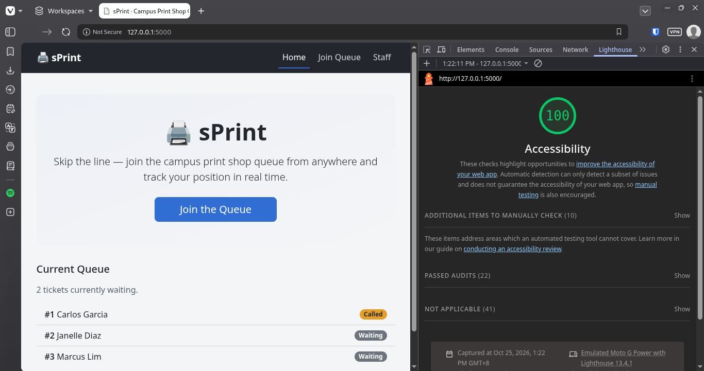
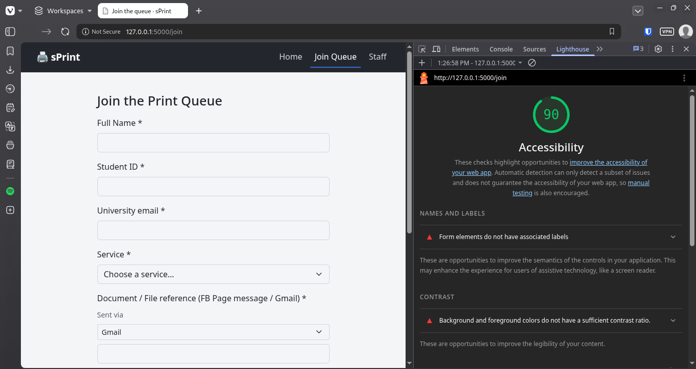
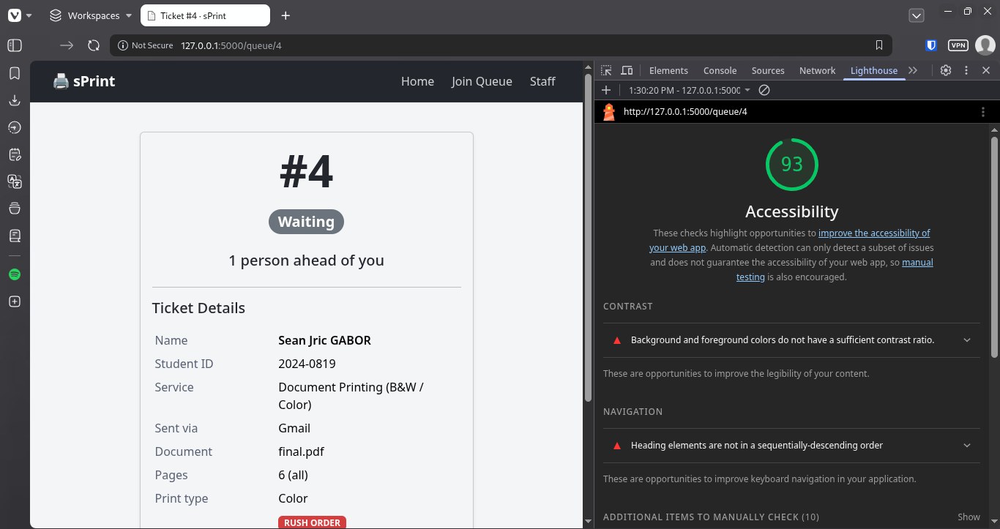
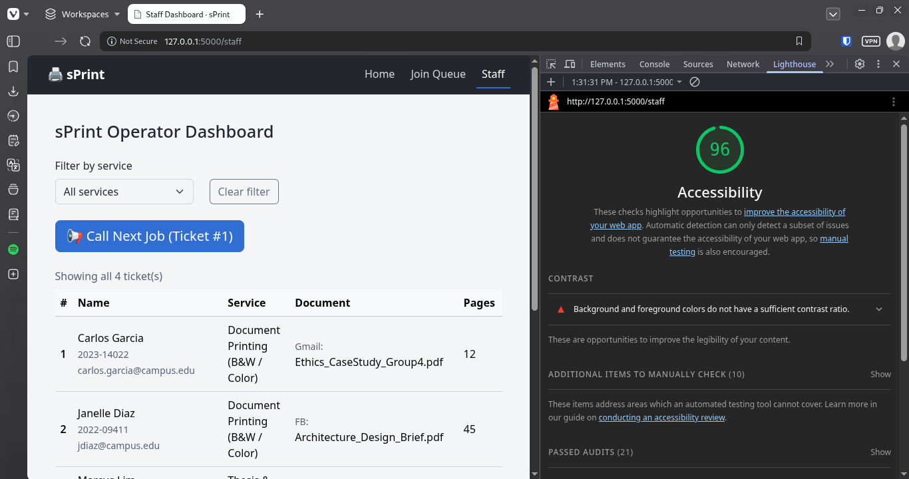

# Week 3 – Accessibility Check

**Student:** Gabor, Sean Jric | **Section:** CS3B
**App:** sPrint – Campus Print Shop Queue Management System

---

## 9a. Lighthouse Scores

### Screen 1: Home Page (index)

**Score:** 100/100

**Screenshot:** 

**Issues found and fixed:**
- None - perfect score

---

### Screen 2: Join Queue Form (join)

**Score:** 90/100

**Screenshot:** 

**Issues found and fixed:**
- Score meets the 90+ requirement

---

### Screen 3: My Place / Ticket (ticket)

**Score:** 93/100

**Screenshot:** 

**Issues found and fixed:**
- Score meets the 90+ requirement

---

### Screen 4: Staff Dashboard (staff)

**Score:** 96/100

**Screenshot:** 

**Issues found and fixed:**
- Score meets the 90+ requirement

---

## 9b. Keyboard-Only Test

**Test Date:** October 25, 2026

**Browsers tested:** Firefox, Vivaldi (Chromium-based)

**Tasks performed:**
1. Join the queue from the home page
2. On the staff dashboard, filter by a service, call a ticket, and serve it

**Results:**

**Works well:**
- Skip link appeared on the first Tab
- Could see where the focus was at every step
- Could reach and use every control
- Successfully navigated from home page to join form using Tab and Enter
- Successfully filled out join form using Tab to move between fields
- Successfully submitted form with Enter
- Successfully navigated to staff dashboard
- Successfully filtered by service using Tab to select dropdown and Arrow keys to choose
- Successfully called a ticket using Tab to focus button and Enter to submit
- Successfully served a ticket using Tab to focus button and Enter to submit

**Problems encountered:**
- Tab navigation initially did not work in Vivaldi browser - focus stayed in URL bar even after clicking page content
- Root cause: Vivaldi's "Webpage focus" setting was set to "Focus on Forms only" instead of "Focus all controls and links"
- After changing the setting to "Focus all controls and links", keyboard navigation worked perfectly in Vivaldi

**Fixes applied:**
- No code fixes needed - issue was browser configuration setting, not a code problem
- Keyboard navigation works correctly in both Firefox and Vivaldi with proper settings

**Notes:**
- Did the skip link appear on the first Tab? Yes (Firefox and Vivaldi)
- Could you see where the focus was at every step? Yes (Firefox and Vivaldi)
- Could you reach and use every control? Yes (Firefox and Vivaldi)

---

## 9c. Manual Checklist

| Check | Join | My place | Staff |
| :--- | :---: | :---: | :---: |
| Every input has a visible label | ✅ | ✅ | ✅ |
| Error messages say what to do, in text | ✅ | ✅ | ✅ |
| Status is shown in words, not only color | ✅ | ✅ | ✅ |
| Text and buttons are readable at 375 px with no sideways page scroll | ✅ | ✅ | ✅ |
| Buttons are at least about 44 × 44 px on a phone | ✅ | ✅ | ✅ |
| Page has one `<h1>` and headings in order | ✅ | ✅ | ✅ |
| `<html lang="en">` (or your language) is set | ✅ | ✅ | ✅ |

**Notes on checklist items marked ❌:**
- None - all items pass

---

## Summary

**Overall Lighthouse scores:**
- Home: 100/100
- Join: 90/100
- Ticket: 93/100
- Staff: 96/100

**Did all screens score 90 or higher?** Yes

**If not, explain what is left and why:**
- All screens meet the 90+ requirement
