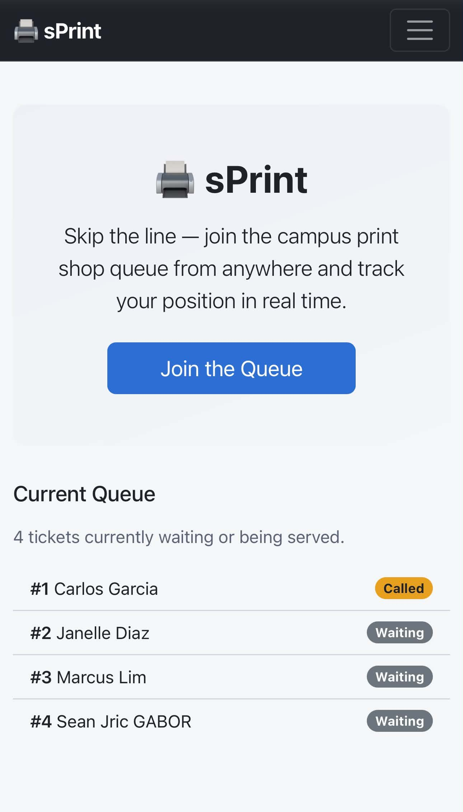
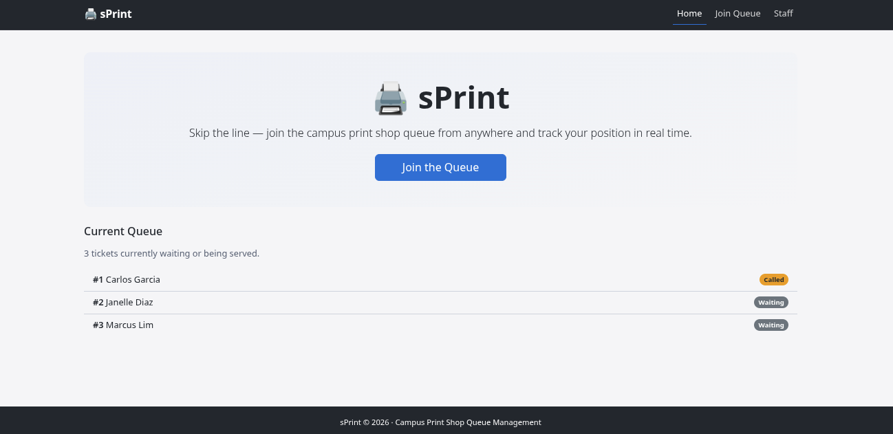
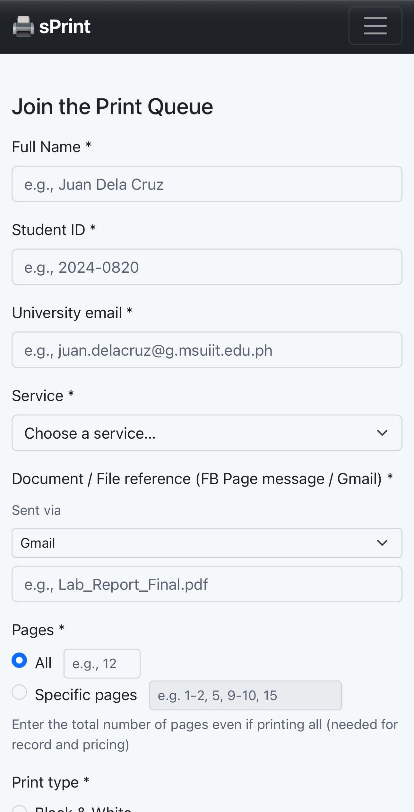
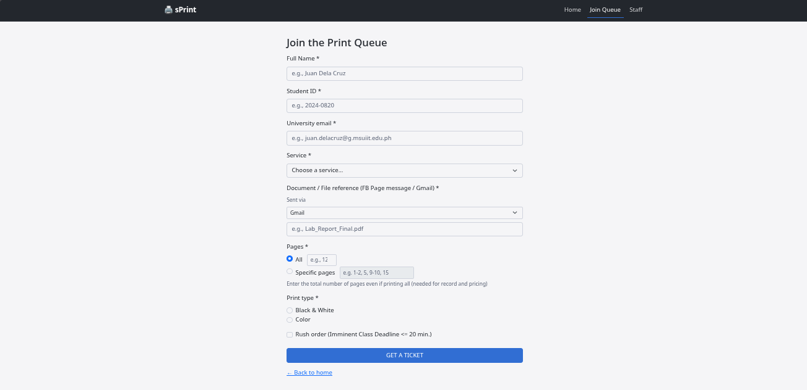
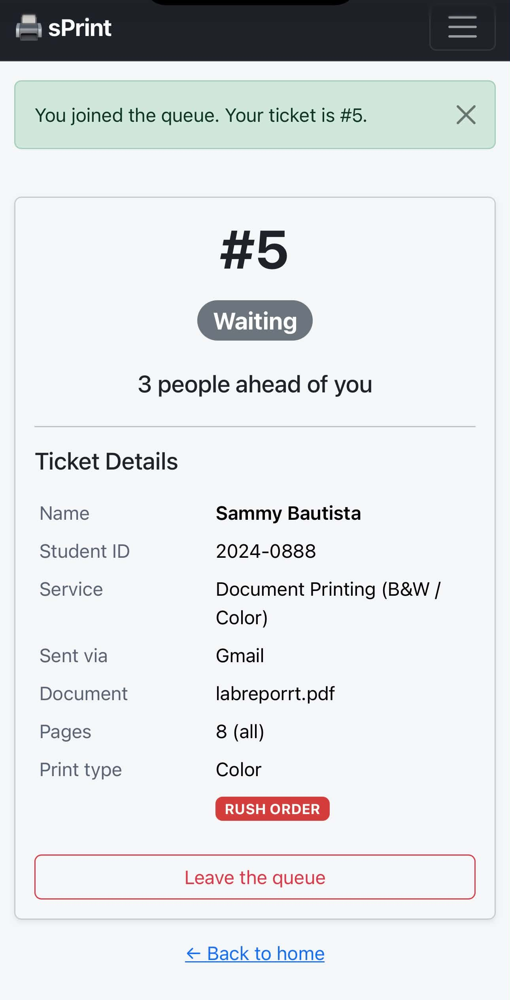
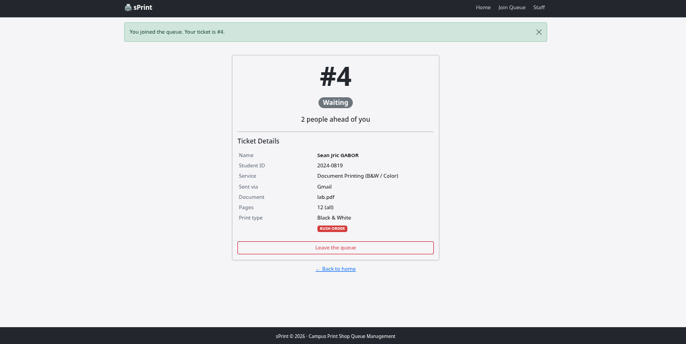
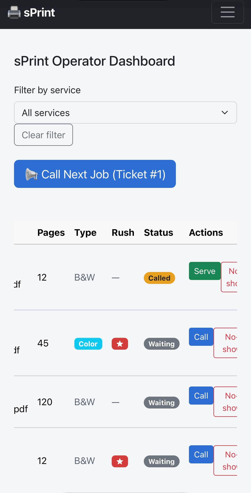
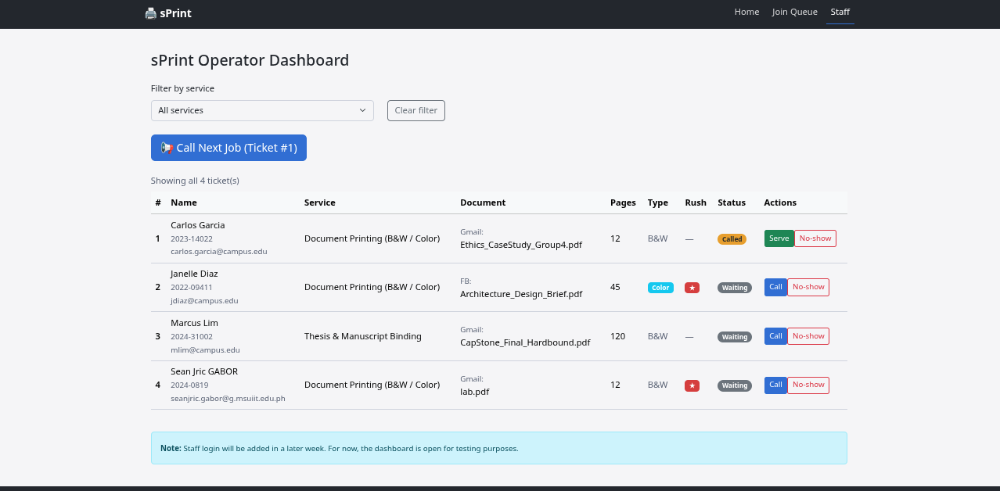

# Week 3 Report: sPrint Interface Development

**App:** sPrint – Campus Print Shop Queue Management System
**Setting:** University Student Center Copy & Print Shop
**Full name:** Gabor, Sean Jric
**Student ID:** 2024-0819
**Section:** CS3B
**Date:** October 24, 2026
**Pull request link:** https://github.com/gitnsaen/ccc181/pull/6

---

## 1. Personas

### Sammy Bautista – the Person Waiting

> *"I already sent my lab report PDF to their Facebook page 20 minutes ago, but Kuya said they only open and print your file when you're physically standing right in front of the counter."*

**Top tasks:**
- Join the print queue with student ID, document reference, and rush priority (Join screen, FR-01, FR-06)
- Check live position and number of print jobs ahead (My place screen, FR-02)
- Observe real-time status update from "Waiting" to "Called" without refreshing (My place screen, FR-03)
- Cancel ticket if she decides to leave or ask a friend instead (My place screen, FR-07)

**Full details:** [Link to docs/week3/personas.md](personas.md)

### Kuya Jun (Nestor) Ramos – the Staff Member

> *"Students message files to our Facebook page and Gmail all morning, but we cannot print in advance because students change their minds, leave campus, or never show up to pay."*

**Top tasks:**
- View active queue ordered by arrival time and rush urgency (Staff dashboard, FR-04)
- Filter queue by service (Printing vs Binding vs Plotting) (Staff dashboard, FR-04a)
- Advance the queue with a single-click "Call Next Job" button (Staff dashboard, FR-05)
- View document title / FB / Gmail file reference before downloading (Staff dashboard, FR-04, FR-06)
- Mark completed jobs as "Served" or mark absent customers as "No-show" (Staff dashboard, FR-05)

**Full details:** [Link to docs/week3/personas.md](personas.md)

---

## 2. Screens

### Screen 1: Home Page (Phone)

**Persona:** Sammy Bautista
**Requirement IDs:** FR-01, FR-02
**Description:** Welcome screen with hero section and current queue snapshot. Large "Join the Queue" button for quick access.

---

### Screen 2: Home Page (Laptop)

**Persona:** Sammy Bautista
**Requirement IDs:** FR-01, FR-02
**Description:** Same content, centered layout on larger screen with full-width navigation.

---

### Screen 3: Join Queue Form (Phone)

**Persona:** Sammy Bautista
**Requirement IDs:** FR-01, FR-06
**Description:** Vertical form layout with all required fields: name, student ID, email, service, document reference (with "Sent via" dropdown), pages (all/specific), print type, and rush checkbox.

---

### Screen 4: Join Queue Form (Laptop)

**Persona:** Sammy Bautista
**Requirement IDs:** FR-01, FR-06
**Description:** Centered form layout with side-by-side radio buttons for better use of screen space.

---

### Screen 5: My Place / Ticket (Phone)

**Persona:** Sammy Bautista
**Requirement IDs:** FR-02, FR-03, FR-07
**Description:** Large ticket number, status badge with text label, position display ("X people ahead" or "You're next!"), ticket details table, and leave queue button.

---

### Screen 6: My Place / Ticket (Laptop)

**Persona:** Sammy Bautista
**Requirement IDs:** FR-02, FR-03, FR-07
**Description:** Same content, centered card layout on larger screen.

---

### Screen 7: Staff Dashboard (Phone)

**Persona:** Kuya Jun Ramos
**Requirement IDs:** FR-04, FR-04a, FR-05, FR-06
**Description:** Service filter dropdown, Call Next button, queue table with horizontal scroll, and action buttons for each ticket.

---

### Screen 8: Staff Dashboard (Laptop)

**Persona:** Kuya Jun Ramos
**Requirement IDs:** FR-04, FR-04a, FR-05, FR-06
**Description:** Full table view with all columns, service filter, and action buttons. Rush priority shown with ★ badge.

---

## 3. Design Decisions

### Decision 1: Large ticket number and status on My place page

**Rationale:** Because Sammy checks her phone while walking between classes (from persona), the ticket number and position must be the biggest thing on My place. I used `display-1 fw-bold` for the ticket number and placed the status badge prominently at the top of the card.

**Persona link:** Sammy Bautista's "Because …, my interface must …" rule #1

---

### Decision 2: "Sent via" dropdown before document reference

**Rationale:** From the wireframe and real-world observation, students send files via Facebook Messenger or Gmail. Adding a "Sent via" dropdown helps Kuya Jun quickly locate the file in the correct inbox. This addresses Kuya Jun's goal of "quickly match the ticket with the student's message on the shop's Facebook Page/Gmail."

**Persona link:** Kuya Jun Ramos's top task #4

---

### Decision 3: Service filter on staff dashboard

**Rationale:** The print shop offers 4 different services. During peak hours, the queue can be long. A service filter allows Kuya Jun to focus on one service type at a time, reducing cognitive load and improving efficiency. This matches the wireframe design and FR-04a requirement.

**Persona link:** Kuya Jun Ramos's top task #2 and FR-04a

---

## 4. Self-Review

**Main problems found in wireframes:**
1. Join form wireframe didn't show error state - fixed by adding server-side validation with field-level error messages
2. Status badge was color-only in wireframe - fixed by adding text labels ("Waiting", "Called", etc.)
3. Action buttons lacked ARIA labels - fixed by adding descriptive `aria-label` attributes on all staff action buttons

**Changes made:**
- Added comprehensive server-side validation with error messages
- Ensured all status badges include text labels for accessibility
- Added ARIA labels to all interactive elements

**Self-review document:** [Link to docs/week3/feedback.md](feedback.md)

---

## 5. Accessibility

**Lighthouse scores:**
- Home: 100/100
- Join: 90/100
- My place: 93/100
- Staff: 96/100

**Most important issue fixed:**
- Removed SRI (Subresource Integrity) attributes from Bootstrap CSS/JS links to fix hamburger menu navigation in development

**Accessibility document:** [Link to docs/week3/accessibility.md](accessibility.md)

---

## 6. Usability Test

**Test participant:** Montejo, Carlo - 2nd year BA Sociology student
**Persona matched:** Sammy Bautista

### Task 1: Join the Queue
- **Result:** Yes
- **Time:** Under 1 minute
- **Notes:** Task executed smoothly. Participant was confused about the filename field and pages field (expected that selecting "All" wouldn't require typing the number). Fixed by adding clear placeholders and helper text.

### Task 2: Check Position
- **Result:** Yes
- **Time:** ~3 seconds
- **Notes:** Immediately knew ticket #7 and saw 3 people ahead. Got confused that the queue list showed served tickets - fixed by filtering to only show waiting and called tickets.

### Task 3: Staff Actions
- **Result:** Yes (with little help)
- **Time:** Under 30 seconds
- **Notes:** Needed help to scroll the table horizontally to find action buttons on mobile view.

**Improvement made:**
Based on usability test, added clear placeholders to all form fields, added helper text for pages field, added JavaScript to disable unused pages input, and fixed home page to only show waiting/called tickets (not served ones).

**Usability test document:** [Link to docs/week3/usability-test.md](usability-test.md)

---

## 7. Reflection

**What was hardest this week:**
- Implementing the unified queue calculation correctly - initially had service-specific filtering which didn't match the real-world context of a campus print shop where all services share one line
- Balancing accessibility requirements with the wireframe design - ensuring status badges had text labels while maintaining the visual design
- Making the pages field UX intuitive - needed to add JavaScript to disable unused inputs and clear helper text

**What you will change when the data moves to a database in Week 4:**
- The TICKETS list will be replaced with PostgreSQL queries, so the ticket lookup and position calculation logic will need to be rewritten using SQL
- The status updates will need to use database UPDATE statements instead of modifying the in-memory list
- Service filtering will use SQL WHERE clauses instead of Python list comprehensions

---

## 8. Declaration

**AI tools or outside sources used:**
- Devin AI (coding assistant) - used for implementing Flask routes, templates, and JavaScript
- Week 2 starter app (from course materials) - used as initial template
- Bootstrap 5.3.3 - CSS framework from CDN
- Flask 3.1.3 - web framework
- Week 3 assignment guide (hw3_queue_app.md) - requirements and specifications
- CCC181 Week 2 and Week 3 HTML slides - reference for Flask and interface development best practices

**Declaration:** I used Devin AI to help implement the code based on the assignment requirements. All design decisions, personas, wireframes, and testing were my own work based on field research at the campus print shop.
