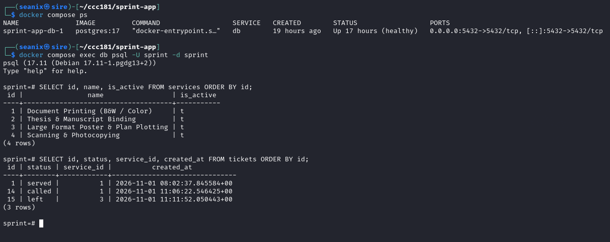
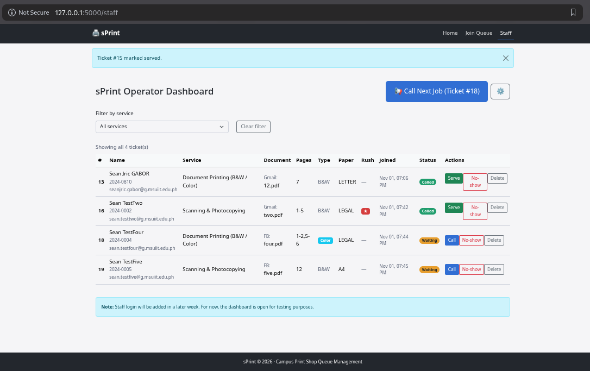
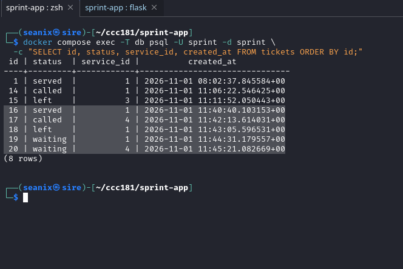
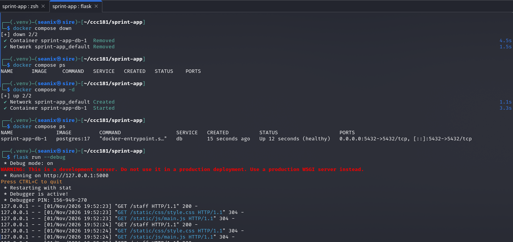
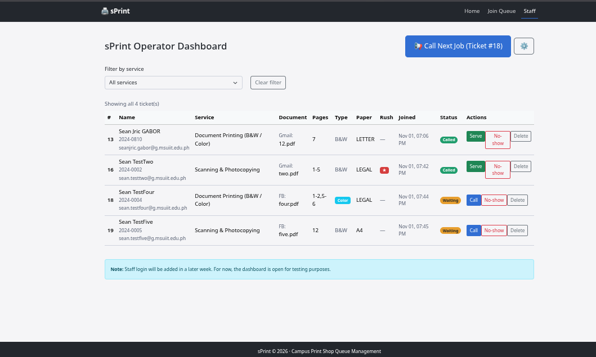
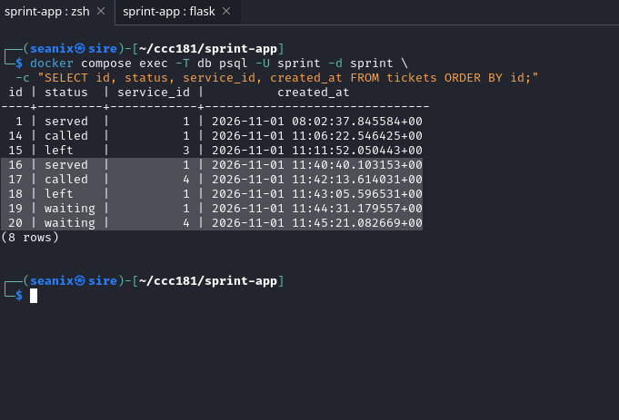
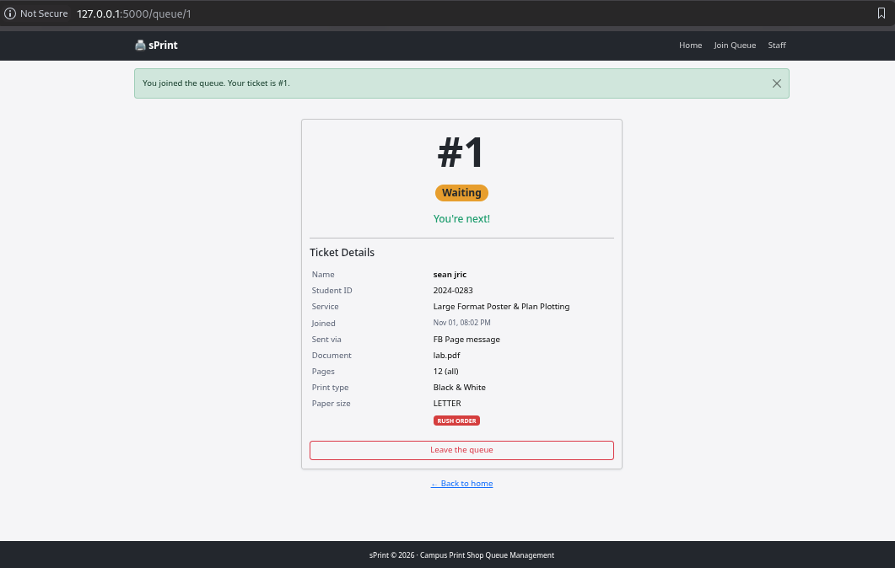

# Persistence Test

## Restart test

I tested the app with five test tickets across at least two services: one was called, one was served, one was left in the queue, and two remained waiting. The database screenshots include all ticket rows present at the time of the test, including earlier tickets.

This is the database before part 11:


Before the restart, I captured the staff dashboard and ran:

```sql
SELECT id, status, service_id, created_at
FROM tickets
ORDER BY id;
```




I stopped Flask, ran `docker compose down`, and confirmed that `docker compose ps` showed no running containers. I then ran `docker compose up -d`, waited until PostgreSQL reported healthy, and started Flask again. The restart steps are also visible in this terminal screenshot:



After restarting, I captured the same staff dashboard and ran the same SQL query:




The before-and-after query outputs contain the same eight ticket rows with the same IDs, statuses, service IDs, and timestamps. The dashboard also shows the same active queue after the restart. **NFR-01 passed** for this restart test.

## Rebuild from scratch

After the restart test, I rebuilt the database from the project migrations and starting service data, then opened the join form and created a ticket. The app displayed the services and successfully created ticket #1 in the rebuilt database:



This confirms the app could accept a ticket after the clean rebuild. The `docker compose down -v` command deletes the Docker database volume and its data; after this rebuild, I will use plain `docker compose down` for normal stops.
