# sPrint — Week 4 Report

## Title details

- **App:** sPrint — Campus Print Shop Queue Management System
- **Setting:** MSU-IIT Document Printing Shop, Ground floor, near COE and CED buildings.
- **Student:** Sean Jric B. Gabor
- **Student ID:** 2024-0819
- **Section:** CS3B
- **Date:** 2026-11-01
- **Branch:** `feature/week4-database`
- **Pull request:** Not created yet. Add the PR link here after opening it.
- **Issue:** #7

## Requirements

I wrote 15 functional requirements and 5 non-functional requirements. The MVP is FR-01, FR-02, FR-03, FR-05, FR-06, FR-07, FR-08, FR-10, FR-11, and FR-14, together with the Must NFRs: NFR-01, NFR-02, NFR-04, and NFR-05.

The student I consulted said they needed an alert when called so they would not have to keep watching the app, and recommended clear status colors and settings that fit the shop. I added the paper-size options while the audio/vibration alert requirement, unreadable-file flag, and estimated time/cost were noted as future features. I also specified high-contrast status colors and kept the single-counter workflow.

See [the full requirements](../requirements.md). Requirements marked **Later** are not part of this week's submission scope. FR-14 service management is implemented.

## ERD

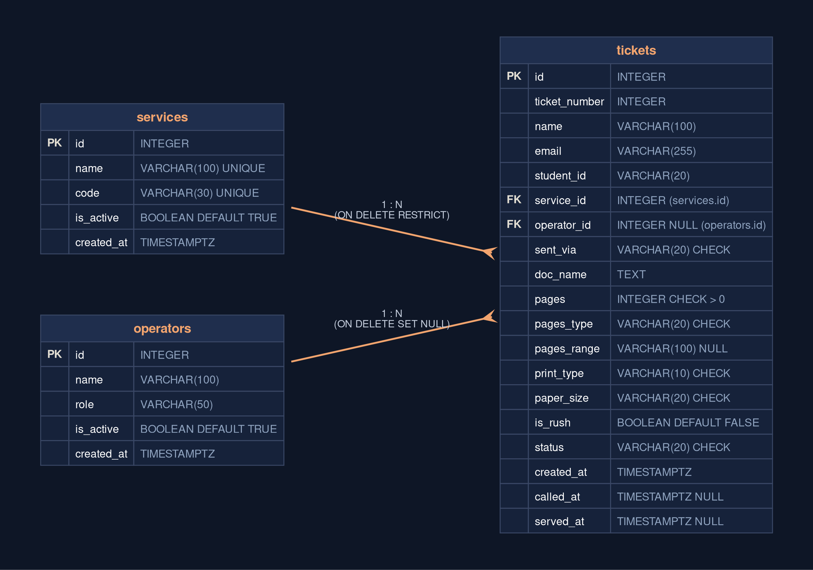

- One service can have zero or many tickets; each ticket belongs to exactly one service.
- One operator can handle zero or many tickets; each ticket is assigned to at most one operator, and the operator reference can be empty.

See [the schema design](schema.md).

## Schema

The following is the PostgreSQL `\d` output for the three tables after applying the project migrations.

### `services`

```text
Table "public.services"
   Column   |           Type           | Collation | Nullable |               Default
------------+--------------------------+-----------+----------+--------------------------------------
 id         | integer                  |           | not null | nextval('services_id_seq'::regclass)
 name       | character varying(100)   |           | not null |
 code       | character varying(30)    |           | not null |
 is_active  | boolean                  |           | not null | true
 created_at | timestamp with time zone |           | not null | now()
Indexes:
    "services_pkey" PRIMARY KEY, btree (id)
    "services_code_key" UNIQUE CONSTRAINT, btree (code)
    "services_name_key" UNIQUE CONSTRAINT, btree (name)
Referenced by:
    TABLE "tickets" CONSTRAINT "tickets_service_id_fkey" FOREIGN KEY (service_id) REFERENCES services(id) ON DELETE RESTRICT
```

### `operators`

```text
Table "public.operators"
   Column   |           Type           | Collation | Nullable |                Default
------------+--------------------------+-----------+----------+---------------------------------------
 id         | integer                  |           | not null | nextval('operators_id_seq'::regclass)
 name       | character varying(100)   |           | not null |
 role       | character varying(50)    |           | not null |
 is_active  | boolean                  |           | not null | true
 created_at | timestamp with time zone |           | not null | now()
Indexes:
    "operators_pkey" PRIMARY KEY, btree (id)
Referenced by:
    TABLE "tickets" CONSTRAINT "tickets_operator_id_fkey" FOREIGN KEY (operator_id) REFERENCES operators(id) ON DELETE SET NULL
```

### `tickets`

```text
Table "public.tickets"
    Column     |           Type           | Collation | Nullable |               Default
---------------+--------------------------+-----------+----------+-------------------------------------
 id            | integer                  |           | not null | nextval('tickets_id_seq'::regclass)
 ticket_number | integer                  |           | not null | generated by default as identity
 name          | character varying(100)   |           | not null |
 email         | character varying(255)   |           | not null |
 student_id    | character varying(20)    |           | not null |
 service_id    | integer                  |           | not null |
 operator_id   | integer                  |           |          |
 sent_via      | character varying(20)    |           | not null |
 doc_name      | text                     |           | not null |
 pages         | integer                  |           | not null |
 pages_type    | character varying(20)    |           | not null |
 pages_range   | character varying(100)   |           |          |
 print_type    | character varying(10)    |           | not null |
 paper_size    | character varying(20)    |           | not null | 'letter'::character varying
 is_rush       | boolean                  |           | not null | false
 status        | character varying(20)    |           | not null | 'waiting'::character varying
 created_at    | timestamp with time zone |           | not null | now()
 called_at     | timestamp with time zone |           |          |
 served_at     | timestamp with time zone |           |          |
Indexes:
    "tickets_pkey" PRIMARY KEY, btree (id)
    "uq_tickets_ticket_number" UNIQUE CONSTRAINT, btree (ticket_number)
Check constraints:
    "check_ticket_pages_type" CHECK (pages_type::text = ANY (ARRAY['all'::character varying, 'specific'::character varying]::text[]))
    "check_ticket_paper_size" CHECK (paper_size::text = ANY (ARRAY['letter'::character varying, 'a4'::character varying, 'legal'::character varying]::text[]))
    "check_ticket_positive_pages" CHECK (pages > 0)
    "check_ticket_print_type" CHECK (print_type::text = ANY (ARRAY['bw'::character varying, 'color'::character varying]::text[]))
    "check_ticket_sent_via" CHECK (sent_via::text = ANY (ARRAY['gmail'::character varying, 'fb'::character varying]::text[]))
    "check_ticket_status" CHECK (status::text = ANY (ARRAY['waiting'::character varying, 'called'::character varying, 'served'::character varying, 'no-show'::character varying, 'unreadable'::character varying, 'left'::character varying]::text[]))
Foreign-key constraints:
    "tickets_operator_id_fkey" FOREIGN KEY (operator_id) REFERENCES operators(id) ON DELETE SET NULL
    "tickets_service_id_fkey" FOREIGN KEY (service_id) REFERENCES services(id) ON DELETE RESTRICT
```

## Design decisions

1. I calculate queue position from waiting tickets instead of storing a position on each ticket. Queue position changes when someone is called or leaves, so storing it would require updating other rows; calculating it when requested supports FR-05 and FR-06.
2. I made ticket numbers database-generated and unique. This avoids duplicate numbers when students join at the same time and supports FR-05 and NFR-02.
3. I put service name, code, and active state on `services`, while each ticket references its service. Staff can deactivate a temporarily unavailable service without losing historical ticket context, supporting FR-09 and FR-14 and the operators' workflow described in the personas.

## Self-review

The review found that `MAX(ticket_number) + 1` could allocate duplicate numbers under concurrent submissions. I replaced it with a PostgreSQL identity and unique constraint. It was also found that the original status constraint did not permit the `left` state used when a student leaves; the follow-up migration adds that status. Finally, the service active flag and editable service catalog allow staff to retire or rename services without deleting records referenced by tickets. See [schema-review.md](schema-review.md).

## Migrations

- [`6e06cc0e3939_initial_tables.py`](../../migrations/versions/6e06cc0e3939_initial_tables.py) creates the `services`, `operators`, and `tickets` tables with their original keys, relationships, defaults, and checks.
- [`a42f39cd6e10_enforce_ticket_number_and_left_status.py`](../../migrations/versions/a42f39cd6e10_enforce_ticket_number_and_left_status.py) adds identity generation and uniqueness for ticket numbers, and permits the `left` ticket status.

## CRUD

- **Create — `POST /join`, FR-01.** The student form creates a ticket and displays its ticket page.

  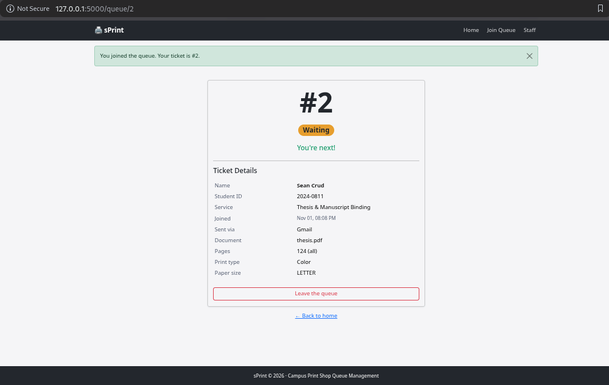

- **Read — `GET /staff`, FR-08.** The operator dashboard reads and lists active queue tickets.

  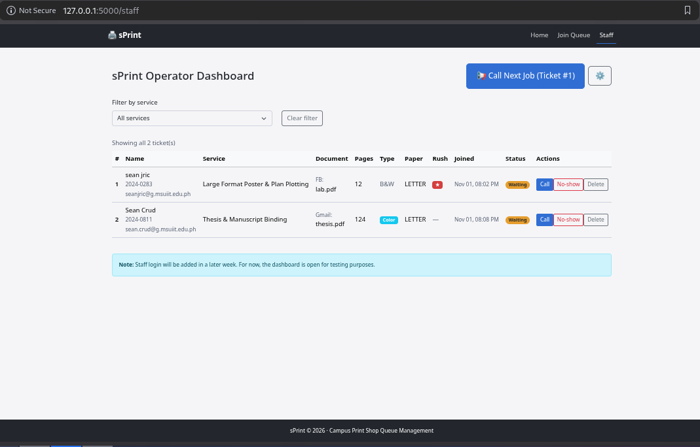

- **Update — `POST /staff/tickets/1/call`, FR-10.** The staff action changes the ticket status to Called.

  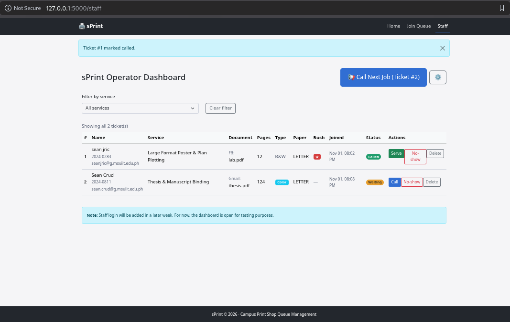

- **Soft delete / leave queue — `POST /queue/3/leave`, FR-07.** Database ticket ID 3 is retained with status `left`.

  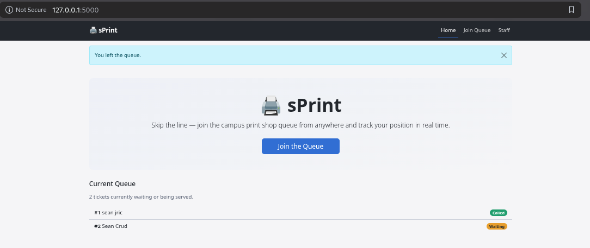

- **Hard delete — `POST /staff/tickets/2/delete`.** Database ticket ID 2 is permanently removed. This is a staff cleanup operation; FR-07 is the separate soft-delete/leave behavior.

  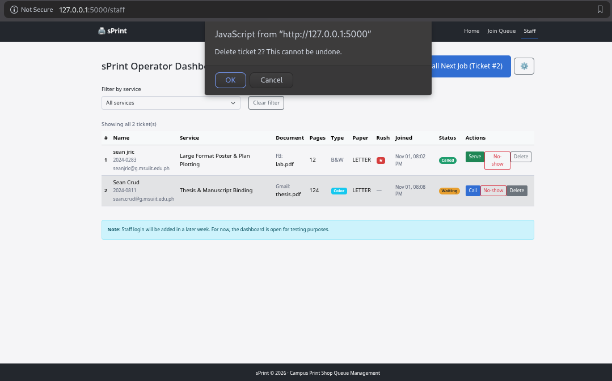
  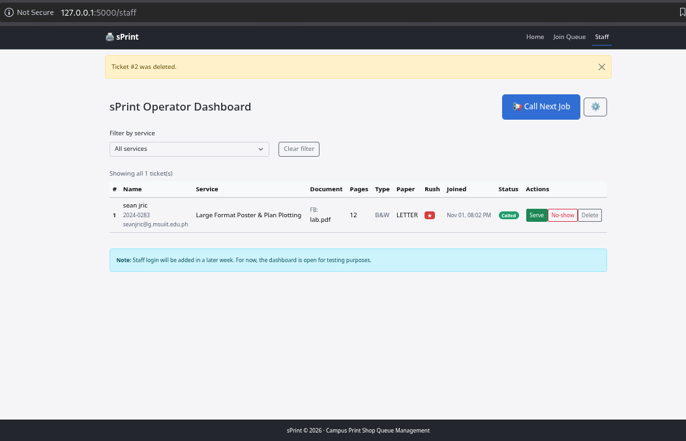

The database evidence shows ticket ID 3 with status `left` and no ticket ID 2 after deletion:

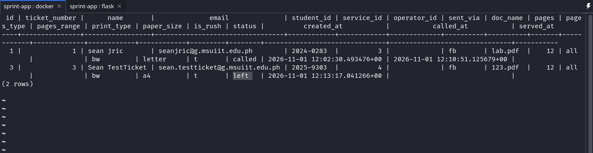

## Validation

Browser validation blocked an empty form and rejected an invalid email. Three invalid `curl` requests (blank name, malformed email, and zero pages) each returned HTTP 400, and the ticket count stayed at 1. Direct PostgreSQL tests rejected invalid foreign keys, status values, duplicate service codes, NULL service names, and deletion of a referenced service. The SQL-in-f-strings check found no matches.

The most useful database error was:

```text
ERROR: insert or update on table "tickets" violates foreign key constraint "tickets_service_id_fkey"
```

See the detailed results in [validation.md](validation.md).

## Persistence

The before-and-after restart screenshots show the same database rows and active dashboard after Docker and Flask were restarted; the recorded NFR-01 restart test passed. After rebuilding the database, the app displayed a join form and created a new ticket.

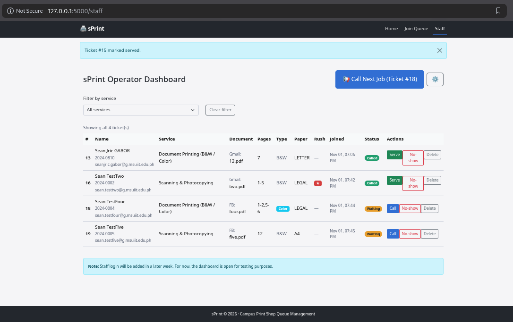
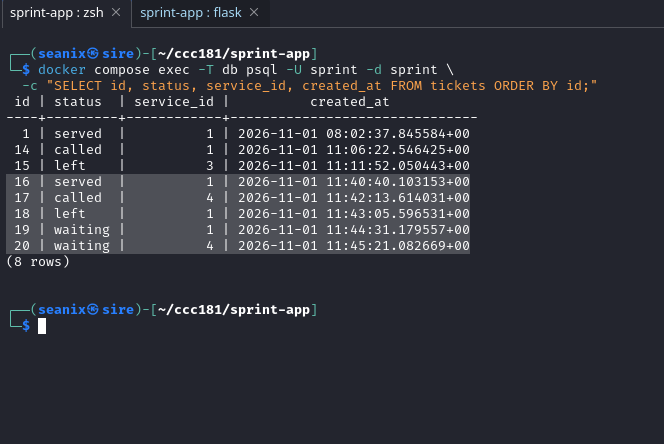
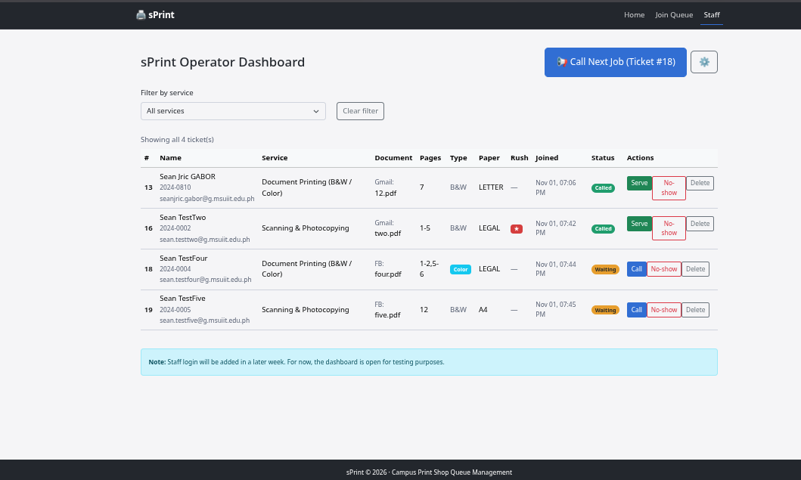
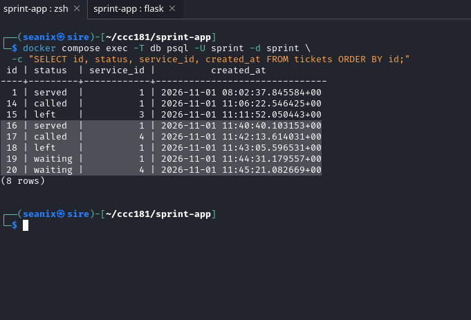
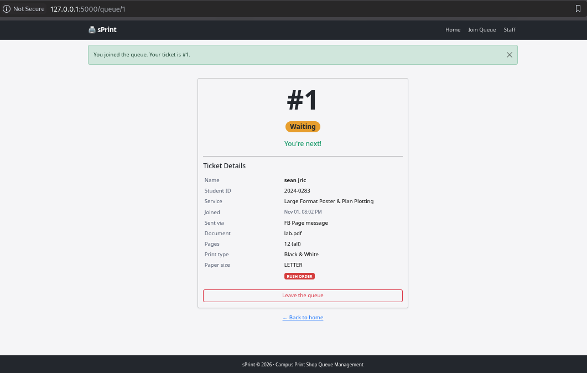

See [persistence.md](persistence.md) for the test sequence and results.

## Reflection

The hardest part this week was making the queue safe to use with real persisted data, especially making ticket numbers unique and preserving the queue history when someone leaves. FR-13 was the hardest requirement to make testable because audio and vibration depend on browser permissions, device support, and a ticket changing to Called while the page is open. That is why I decided to implement that in  a later time. A useful report for Kuya Jun would show how many students leave before being served, grouped by service and day; I can build that query in Week 5.

## Declaration

I used the Google Gemini to help me with understanding instructions, and understand the code. I personally reviewed the resulting content and screenshots.
