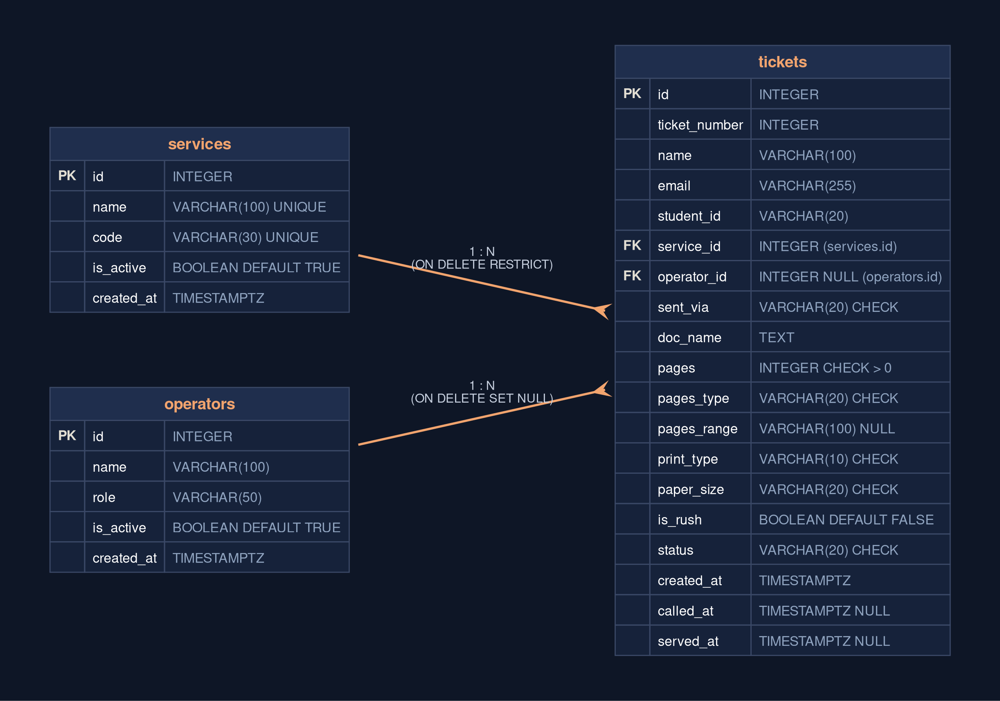

# sPrint Database Schema Design & ERD

This document specifies the relational database schema for **sPrint** (Campus Print Shop Queue Management System), designed directly from the requirements in [`docs/requirements.md`](../requirements.md) and adhering to the PostgreSQL architecture from Week 4.

---

## 2a. Noun Extraction & Entity Identification

Reviewing the **Stores data? = Yes** column in our requirements specification yields the following real-world nouns:

| Requirement ID | Relevant Domain Nouns Mentioned | Associated Responsibility |
| :--- | :--- | :--- |
| **FR-01** | Student, Name, Email, Student ID, Service, Queue Ticket | Collecting customer identity and service selection upon queuing |
| **FR-02 ★** | Document Reference, File Name, Submission Channel (Gmail, FB) | Storing file lookup information for operator inbox matching |
| **FR-03 ★** | Page Scope, Page Range, Color Mode, Paper Size | Storing document physical printing parameters |
| **FR-04 ★** | Rush Order Tag | Indicating queue priority level |
| **FR-05** | Ticket Number, Status, Position, Timestamp | Tracking ticket queue progression |
| **FR-07** | Cancelled Ticket, No-Show Status | Updating state when student departs |
| **FR-08** | Staff Dashboard, Queue Arrival Order | Ordering and displaying active tickets |
| **FR-09** | Service Filter | Filtering queue records by service category |
| **FR-10** | Operator, Called Ticket, Counter Call Time | Assigning operator and recording calling timestamp |
| **FR-11** | Served Ticket, No-Show Ticket, Completion Time | Recording transaction resolution and timestamps |
| **FR-12 ★** | Unreadable Document Flag | Flagging unopenable files for student re-submission |
| **FR-14** | Print Service Offering, Availability Flag, Service Code | Managing the catalog of offered services |

### Grouping into Core Entities (Tables)
These nouns group cleanly into **three related relational tables**:

1. **`services`** (Catalog Entity)  
   Represents print shop service categories (e.g., Document Printing, Thesis Binding, Poster Plotting, Scanning). Managed by operators to enable/disable specific options during equipment maintenance.
2. **`operators`** (Staff Entity)  
   Represents the campus copy center personnel (e.g., Kuya Jun Ramos as Head Operator, Ate Karen as Student Assistant) who call, process, and complete student jobs at the counter.
3. **`tickets`** (Core Transactional Entity)  
   Represents individual queue entries submitted by students. Holds customer identification, file references, printing specifications, current lifecycle status, and foreign key references to both the requested service and the assigned operator.

---

## 2b. Table Definitions, Data Types & Constraints

### 1. `services` Table
Stores all print shop service offerings.

| Column | Data Type | Nullable? | Constraints / Defaults | Rationale & Purpose |
| :--- | :--- | :--- | :--- | :--- |
| `id` | `INTEGER` | **No** | `PRIMARY KEY GENERATED ALWAYS AS IDENTITY` | Standard synthetic primary key for row identification. |
| `name` | `VARCHAR(100)` | **No** | `UNIQUE` | Human-readable service name displayed in dropdowns. |
| `code` | `VARCHAR(30)` | **No** | `UNIQUE` | Machine-readable slug (e.g., `'print_doc'`, `'bind_thesis'`). |
| `is_active` | `BOOLEAN` | **No** | `DEFAULT TRUE` | Soft-switch to disable unavailable services without deleting historical records. |
| `created_at` | `TIMESTAMPTZ` | **No** | `DEFAULT CURRENT_TIMESTAMP` | Audit timestamp of when the service was created. |

---

### 2. `operators` Table
Stores campus print shop personnel records.

| Column | Data Type | Nullable? | Constraints / Defaults | Rationale & Purpose |
| :--- | :--- | :--- | :--- | :--- |
| `id` | `INTEGER` | **No** | `PRIMARY KEY GENERATED ALWAYS AS IDENTITY` | Synthetic primary key for operator accounts. |
| `name` | `VARCHAR(100)` | **No** | None | Full name of the staff member (e.g., "Nestor 'Kuya Jun' Ramos"). |
| `role` | `VARCHAR(50)` | **No** | None | Operational role (e.g., `'Head Operator'`, `'Student Assistant'`). |
| `is_active` | `BOOLEAN` | **No** | `DEFAULT TRUE` | Marks whether the operator is currently on active duty. |
| `created_at` | `TIMESTAMPTZ` | **No** | `DEFAULT CURRENT_TIMESTAMP` | Record creation audit timestamp. |

---

### 3. `tickets` Table
Stores student queue tickets and job specifications.

| Column | Data Type | Nullable? | Constraints / Defaults | Rationale & Purpose |
| :--- | :--- | :--- | :--- | :--- |
| `id` | `INTEGER` | **No** | `PRIMARY KEY GENERATED ALWAYS AS IDENTITY` | Database-level unique identifier for internal joins. |
| `ticket_number` | `INTEGER` | **No** | None | Monotonically increasing queue number displayed to the student. |
| `name` | `VARCHAR(100)` | **No** | None | Student customer's full name. |
| `email` | `VARCHAR(255)` | **No** | None | Contact email address for notifications and lookups. |
| `student_id` | `VARCHAR(20)` | **No** | None | University student ID (e.g., `'2023-14022'`). |
| `service_id` | `INTEGER` | **No** | `FOREIGN KEY REFERENCES services(id)` | Identifies the requested service. |
| `operator_id` | `INTEGER` | **Yes** | `FOREIGN KEY REFERENCES operators(id)` | Identifies the operator who called/served this ticket (NULL while waiting). |
| `sent_via` | `VARCHAR(20)` | **No** | `CHECK (sent_via IN ('gmail', 'fb'))` | Submission channel used to transmit the document. |
| `doc_name` | `TEXT` | **No** | None | Document file name or subject line reference. |
| `pages` | `INTEGER` | **No** | `CHECK (pages > 0)` | Total number of pages to be printed. |
| `pages_type` | `VARCHAR(20)` | **No** | `CHECK (pages_type IN ('all', 'specific'))` | Page selection scope. |
| `pages_range` | `VARCHAR(100)` | **Yes** | None | Comma-separated page numbers/ranges (e.g., `'1-5, 8, 12'`) if `pages_type = 'specific'`. |
| `print_type` | `VARCHAR(10)` | **No** | `CHECK (print_type IN ('bw', 'color'))` | Color mode. |
| `paper_size` | `VARCHAR(20)` | **No** | `DEFAULT 'letter'`, `CHECK (paper_size IN ('letter', 'a4', 'legal'))` | Physical paper stock requested. |
| `is_rush` | `BOOLEAN` | **No** | `DEFAULT FALSE` | Priority flag for urgent classroom deadlines. |
| `status` | `VARCHAR(20)` | **No** | `DEFAULT 'waiting'`, `CHECK (status IN ('waiting', 'called', 'served', 'no-show', 'unreadable'))` | Current lifecycle state of the ticket. |
| `created_at` | `TIMESTAMPTZ` | **No** | `DEFAULT CURRENT_TIMESTAMP` | Timestamp of when the student joined the queue. |
| `called_at` | `TIMESTAMPTZ` | **Yes** | None | Timestamp of when staff called the ticket to the counter. |
| `served_at` | `TIMESTAMPTZ` | **Yes** | None | Timestamp of when the job was completed/marked served. |

---

## 2c. Relationships & Referential Integrity Rules

```
services (1) ─────────────< (0..N) tickets
operators (1) ────────────< (0..N) tickets
```

### 1. `services` to `tickets` (One-to-Many)
- **Foreign Key:** `tickets.service_id` references `services.id`.
- **Relationship:** One service can have zero, one, or many associated tickets over time. Each ticket belongs to exactly one service.
- **Referential Action:** `ON DELETE RESTRICT`
  - **Why:** We must never allow deleting a service category while active or historical tickets reference it. If a print shop stops offering large poster plotting, an administrator sets `is_active = FALSE` (soft deactivation). Using `RESTRICT` guarantees database-level integrity against accidental data corruption.

### 2. `operators` to `tickets` (One-to-Many)
- **Foreign Key:** `tickets.operator_id` references `operators.id`.
- **Relationship:** One operator can call and serve zero, one, or many tickets during their shifts. Each ticket is handled by at most one operator (and is `NULL` while still waiting in line).
- **Referential Action:** `ON DELETE SET NULL`
  - **Why:** If a staff member account or student assistant profile is ever pruned or archived, the customer's historical ticket record must remain intact for analytics, logs, and queue history.

---

## 2d. Entity-Relationship Diagram (ERD)

The diagram below illustrates the 3 core entities, their attributes, keys, and crow's foot relationships:



### Reading the Relationships Aloud
- **`services` to `tickets` (1 : N):** *"One service categorizes many tickets. Each ticket belongs to exactly one service."* The foreign key `service_id` sits on the 'many' side (`tickets`).
- **`operators` to `tickets` (1 : N):** *"One operator handles many tickets over time. Each ticket is handled by at most one operator (or none while still waiting in line)."* The foreign key `operator_id` sits on the 'many' side (`tickets`).

---

## 2e. Check That It Is Normalized

To verify that the schema is sound and avoids operational anomalies, we evaluate it against the three normal forms:

### 1. One value per cell (1NF): Does any column hold a list, such as `"Haircut, Shave"`?
**No.** Every column stores atomic, single values:
- `pages` is a single integer count.
- `print_type` is a single scalar choice (`'bw'` or `'color'`).
- `paper_size` is a single scalar choice (`'letter'`, `'a4'`, or `'legal'`).
- `service_id` is a single integer foreign key pointing to exactly one service. A student queues for one specific service per ticket. If a customer needs both printing and thesis binding, they submit a combined workflow service or two distinct queue tickets.
- The `pages_range` field (e.g., `"1-5, 8"`) is stored as a raw customer-entered instruction string for the print operator, not an embedded multi-value relational set. The actual computational metric (total pages) is stored separately as a strict integer in `pages`.

### 2. Depends on the whole key (2NF): In each join table, does every extra column depend on *both* keys?
**Yes.** All tables in our design use a single-column primary key (`id` generated as an identity integer).  
In relational database theory, partial key dependencies can only occur when a table has a composite primary key (a primary key made of two or more columns). Because every table in sPrint has a single-column primary key, every non-key column automatically depends on the whole primary key.

### 3. No hidden copies (3NF): Would you ever have to update the same fact, such as a person's email or a service's name, in more than one row?
**No.** 
- Service metadata (name, code, active status) lives strictly in `services`. If Kuya Jun renames `"Document Printing"` to `"Document Printing (B&W / Color)"`, we update **only one row** in `services`. Every ticket linked via `service_id` automatically reflects this change without data divergence.
- Operator metadata (name, role, active status) lives strictly in `operators`. If Ate Karen's operational role updates, only her single row in `operators` changes.
- There are no transitive dependencies ($X \rightarrow Y \rightarrow Z$) where a non-key column determines another non-key column. Each ticket captures the transactional customer contact details for that specific queue instance (standard guest queue model).

---

## 2f. Requirement-to-Schema Traceability Matrix

Every single table, foreign key, and column directly traces back to our requirements specification in `docs/requirements.md`:

| Requirement ID | Requirement Description | Corresponding Table | Target Column(s) & Constraints |
| :--- | :--- | :--- | :--- |
| **FR-01** | Student joins with contact details & service | `tickets`, `services` | `tickets.name`, `tickets.email`, `tickets.student_id`, `tickets.service_id` |
| **FR-02 ★** | Document file name & submission channel | `tickets` | `tickets.sent_via` (`CHECK IN ('gmail', 'fb')`), `tickets.doc_name` |
| **FR-03 ★** | Page count, range, print type & paper size | `tickets` | `tickets.pages`, `tickets.pages_type`, `tickets.pages_range`, `tickets.print_type`, `tickets.paper_size` |
| **FR-04 ★** | Rush order flag | `tickets` | `tickets.is_rush` (`BOOLEAN DEFAULT FALSE`) |
| **FR-05** | View ticket number, status & position | `tickets` | `tickets.ticket_number`, `tickets.status`, `tickets.created_at` |
| **FR-07** | Cancel ticket / leave queue | `tickets` | `tickets.status` updated to `'no-show'` |
| **FR-08** | Staff dashboard active tickets view | `tickets` | `tickets.status` filter (`'waiting'`, `'called'`), ordered by `created_at` |
| **FR-09** | Filter queue by service type | `tickets`, `services` | Filter query on `tickets.service_id = services.id` |
| **FR-10** | Operator calls next waiting ticket | `tickets`, `operators` | `tickets.status` $\rightarrow$ `'called'`, `tickets.called_at`, `tickets.operator_id` |
| **FR-11** | Operator marks ticket served or no-show | `tickets` | `tickets.status` $\rightarrow$ `'served'` / `'no-show'`, `tickets.served_at` |
| **FR-12 ★** | Flag unreadable / missing file | `tickets` | `tickets.status` $\rightarrow$ `'unreadable'` |
| **FR-14** | Staff manage service catalog | `services` | `services.name`, `services.code`, `services.is_active` |
| **NFR-01** | Data persistence across reboots | All | Managed via PostgreSQL container with named persistent Docker volume |
| **NFR-02** | No duplicate queue tickets | `tickets` | Database identity sequence and monotonic allocation |

